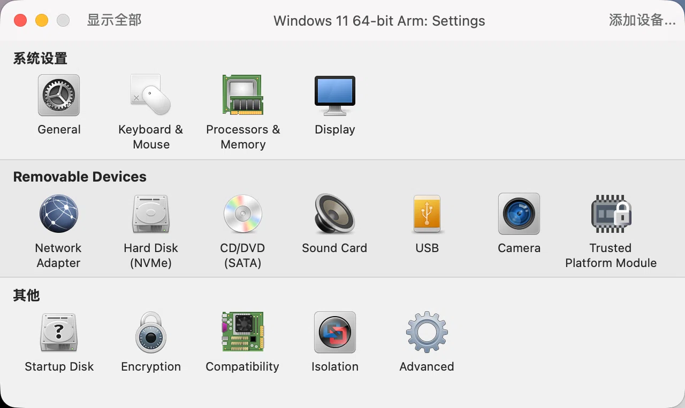
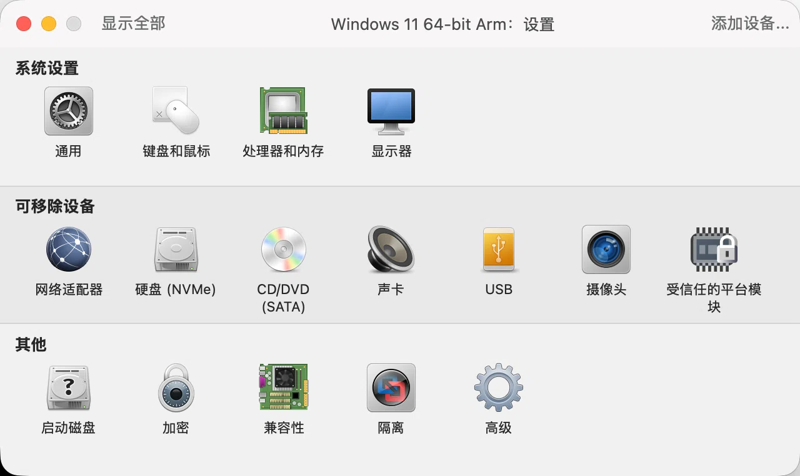
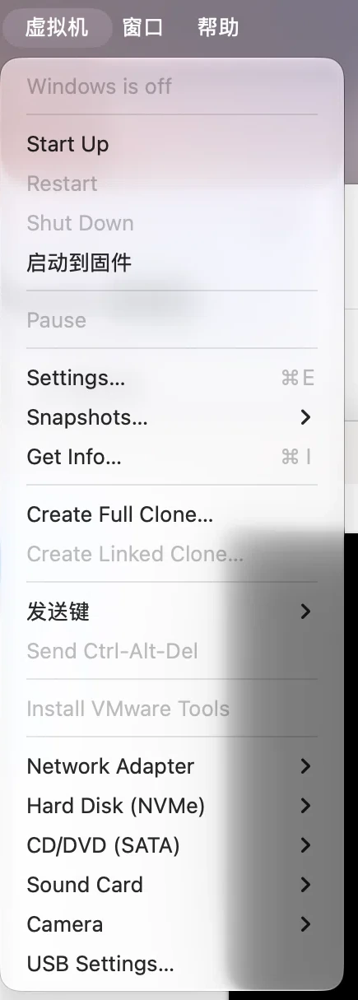
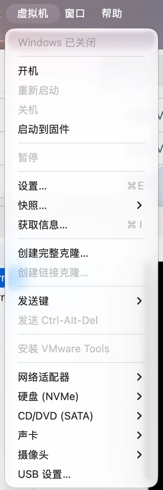
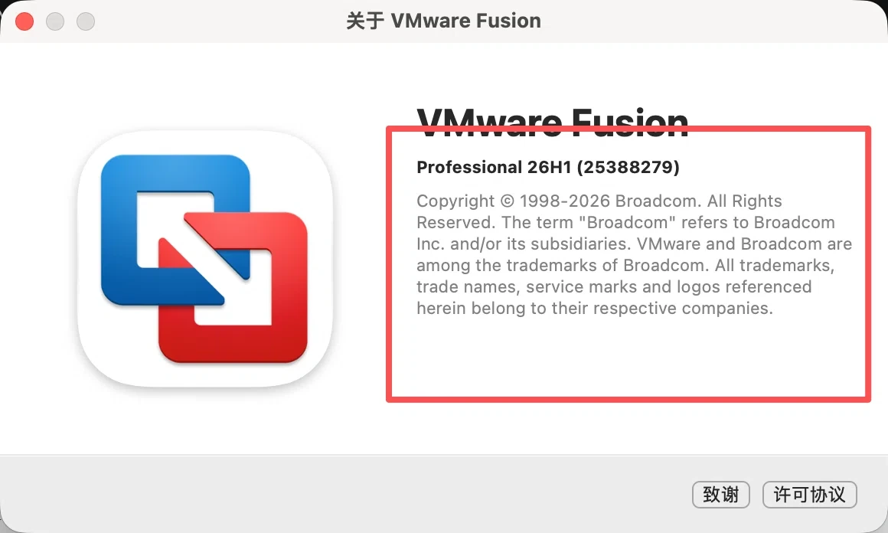
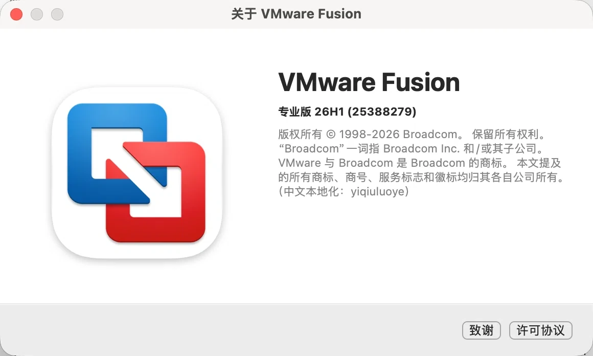
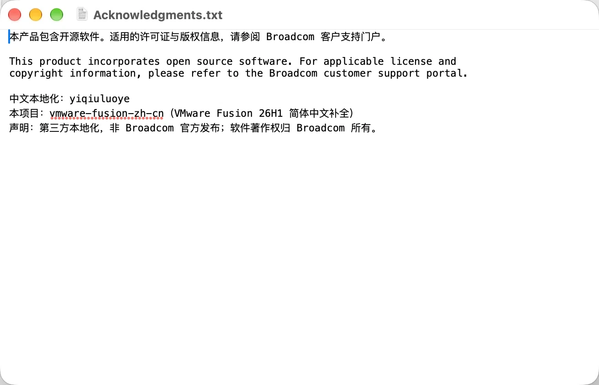

# vmware-fusion-zh-cn

**VMware Fusion 26H1 简体中文补全补丁** · Chinese (zh-CN) localization patch for VMware Fusion on macOS

VMware Fusion 官方只提供 English / French / Japanese / Spanish 四种语言的完整本地化，
简体中文（`zh-Hans`）只有半套——`zh-Hans.lproj` 里 104 张字符串表缺了 16 张；至于代码里的文案，
`Contents/Library/messages/` 下根本没有 `zh-Hans` 目录（只有 es / fr / ja）。

本项目就是给 macOS 版 Fusion 做**汉化 / 中文化**的：补齐这些字符串表，并新建整套
中文消息目录。装完之后界面基本全中文，不再需要任何第三方「中文语言包」。

- 适用版本：VMware Fusion Pro 26H1（26.0.0，build 25388279），macOS 27.x
- 不修改任何可执行代码，只替换语言资源
- 无需重新签名，因此 hypervisor / device-access / 钥匙串权限原样保留

## 适用范围（先看这个）

> **本补丁只适用于 macOS 上的 VMware Fusion，不适用于 Windows。**

| 产品 | 平台 | 适用 | 说明 |
|---|---|---|---|
| **VMware Fusion** | **macOS** | ✅ **本补丁的目标** | 官方只有半套中文：`zh-Hans.lproj` 缺 16 张表，代码文案完全没有中文消息目录 |
| VMware Workstation | Windows / Linux | ❌ **不适用，别装** | 官方已提供完整简体中文，界面本来就是全中文；装本补丁没有意义，也不该装 |
| 其他虚拟化软件 | 任意 | ❌ 不适用 | VMware Workstation / Player / Parallels / UTM / VirtualBox 都不是本补丁的适用对象 |

**Windows 用户请注意**：如果你在 VMware Workstation 里看到英文，那是语言设置的问题
（`Edit → Preferences → 语言` 选简体中文），跟语言包缺失无关——本补丁一点都不适用于 Windows，
补丁里的文件路径（`.app`、`Contents/Resources`）在 Windows 上根本不存在。

## 效果对比

同一台机器、同一个虚拟机，安装前 / 安装后：

<table>
<tr><th align="center">安装前</th><th align="center">安装后</th></tr>
<tr>
<td></td>
<td></td>
</tr>
<tr><td align="center">虚拟机设置：磁贴全是英文</td><td align="center">磁贴全部中文</td></tr>
</table>

<table>
<tr><th align="center">安装前</th><th align="center">安装后</th></tr>
<tr>
<td></td>
<td></td>
</tr>
<tr><td align="center">虚拟机菜单：Start Up / Settings / Snapshots…</td><td align="center">开机 / 设置… / 快照… 全中文</td></tr>
</table>

<table>
<tr><th align="center">安装前</th><th align="center">安装后</th></tr>
<tr>
<td></td>
<td></td>
</tr>
<tr><td align="center">关于窗口：Professional / 英文版权段</td><td align="center">专业版 / 中文版权段 / 末尾署名</td></tr>
</table>

<p align="center">
<br>
<sub>致谢页：中文在上、英文原文在下，底部为汉化署名</sub>
</p>

## 覆盖内容

| 层 | 位置 | 本项目 |
|---|---|---|
| `.strings` | `Resources/zh-Hans.lproj/*.strings` | 新增 21 张表，补 19 个缺失键，共 **245 条** |
| nib 字面量 | `Resources/Base.lproj/*.nib` | 修 1 处（把写死的标题改为走本地化表）|
| **`.vmsg`** | `Library/messages/zh-Hans/vmware.vmsg` | **新建，2715 条**：`msg.*` 与 `button.*` 两套前缀 |
| 法律文本 | `zh-Hans.lproj/EULA.rtf`、`Credits.html` | 中英对照（中文在上，英文原文在下），安装时生成 |

覆盖范围：设置面板全部磁贴与选项、虚拟机菜单与设备子菜单、发送键、全部对话框与按钮、
磁盘/快照/VMDB/检查点/串口/配置文件解析等运行时错误、许可证激活、组件下载进度。

**有意未翻译**：客户机操作系统名称表（`button.guest*`，属产品名）、`vmrun` 命令行输出、
`foundryErrMsgId` 内部错误码、三枚 JIS 键盘键（`変換 / 無変換 / ひらがな`，硬编码在二进制
按键表里，不在任何消息目录，要改需破坏代码签名，得不偿失）。


## 使用前

```bash
python3 fzp.py doctor     # 环境体检：版本、架构、写入权限一次看清
```

安装前做三项检查，不通过会直接中止（不改任何文件）：

| 检查 | 不通过时 |
|---|---|
| 版本为 26H1（26.0.0 / build 25388279） | 提示词条可能错位，需 `--force` 才继续 |
| 主机是否 arm64（本项目实测环境） | 非 arm64 主机 → 拒绝，需 `--force`；Intel 未经验证 |
| 能写入 `/Applications`（macOS 14+ 的「App 管理」权限）| 给出授权路径与重开终端的提示 |

**首次使用请先授权**：系统设置 → 隐私与安全性 → **App 管理** → 勾选你运行命令的终端
（Terminal / iTerm2 / VS Code / Codex）。授权后必须**完全退出该终端再重新打开**，
权限只在进程启动时读取。若列表里没有该项，先执行一次 `sudo python3 fzp.py install`
触发系统提示。

## 已验证环境

| 项目 | 值 |
|---|---|
| Fusion | 26H1，26.0.0，build 25388279（universal，含 x86_64 + arm64 切片）|
| 主机 | Apple Silicon（M5），macOS 27.2 |

**Intel Mac 未验证。** 补丁只替换语言资源、不修改任何可执行代码，理论上与架构无关，
但被修改的 nib 存在两种编译变体（`keyedobjects.nib` 与 NIBArchive 的
`keyedobjects-101300.nib`），我们只改了前者，另一份原样保留。因此：
即使资源不匹配，最坏结果也只是个别文案仍为英文，不会导致崩溃或功能异常——
但请自行承担未验证的风险，预检会要求 `--force`。

## 安装

**三步：解压 → 双击 `安装.command` → 输入登录密码。**

只用命令行也行：

```bash
./fzp.py            # 安装（自动申请管理员权限）
./fzp.py uninstall  # 回滚
./fzp.py status     # 查看装了什么、是否最新
```

装完**退出并重新打开 VMware Fusion**（消息目录只在启动时加载）。

如果 macOS 提示「无法验证开发者」：右键 `安装.command` → **打开**，或直接用上面的命令。

安装过程会：

1. 预检版本 / 架构 / 写入权限，不通过就中止且不改任何文件
2. 退出 Fusion，备份要覆盖的文件到 `backup/<时间戳>-v<版本>/`
3. 写入 `zh-Hans/*.strings`、`vmsg/vmware.vmsg`、nib 修补
4. 从**本机已安装的** Fusion 读取英文 EULA，合成中英对照；生成致谢页
5. 校验全部字符串表，写入 `.fzp-manifest.json` 以便精确回滚

## 目录结构

```
fzp.py                      唯一入口（可直接 ./fzp.py，无参数=安装）
安装.command / 卸载.command   双击即可执行
vmsg/vmware.vmsg            消息目录（译文的源，可直接编辑）
zh-Hans/*.strings           整表补全（21 张）
merge/*.append.strings      已有表的增量补丁（6 张）
v2/                         nib 补丁与附加表
legal/eula_zh.txt           协议中文译本（英文原文安装时从本机读取，不入库）
legal/build_legal.py        生成中英对照 EULA / Credits / 致谢
legal/apply_signature.py    署名注入（由 fzp.py 调用）
signature.txt               署名来源（第一行即显示内容）
tools/fusion-toolbar-fix.sh macOS 27 工具栏崩溃的规避开关
docs/toolbar-crash.md       该崩溃的成因与规避说明
legacy/                     早期拆分的构建脚本，仅作参考，可删
```

## 已知限制

- Fusion 升级会覆盖整个 app，补丁需要重装
- 26H1 在 macOS 27 上存在一个与本项目无关的崩溃（工具栏布局死循环），规避见 `docs/toolbar-crash.md`
- 汉化只覆盖语言资源，不改变任何功能行为

## 免费声明（请勿购买）

**本项目永久免费，不存在任何付费版本、也不授权任何人代收费用。**

唯一的官方下载地址是本仓库的 [Releases](https://github.com/yiqiuluoye/vmware-fusion-zh-cn/releases)。
其他任何地方（网盘、公众号、论坛附件、电商平台）出现的"整合包""汉化版""一键安装版"，
只要向你收费，都不是本项目发布的。

### 如果你已经被收费

1. **先申请退款**（订单未确认收货时最容易）
2. 保留截图：商品页、聊天记录、付款凭证
3. 在对应平台举报该商品（拼多多 / 闲鱼 / 淘宝的商品页都有"举报"入口，
   理由选"侵犯知识产权"或"虚假宣传"）
4. 到本仓库 [提一个「举报倒卖」Issue](https://github.com/yiqiuluoye/vmware-fusion-zh-cn/issues/new?template=resale.md)，
   附上平台与链接，方便其他人避开

### 关于许可证的一点说明

本项目使用 GPL-3.0。GPL 允许他人**收取分发费用**（比如刻盘、代下载），
但前提是：必须一并提供完整源代码、保留原始许可与署名、并明确告知接收者同样享有 GPL 权利。
**收了钱却不给源码、抹掉署名、或者谎称是自己原创，就已经违反许可证**——
这种情况欢迎直接举报。

## 许可

本项目以 **GNU General Public License v3.0** 授权。

- 英文原文（唯一有效版本）：[LICENSE](LICENSE)
- 中文对照说明（逐条要点 + 术语表，非官方译本）：[LICENSE.zh-CN.md](LICENSE.zh-CN.md)

简单说：可以自由使用、修改、商用；但**修改后再分发必须同样以 GPLv3 开源，
并保留原作者署名与修改说明**。分发二进制时须一并提供对应源代码。

```
Copyright (C) 2026 yiqiuluoye
```

## 声明

第三方本地化项目，**非 Broadcom / VMware 官方发布**。VMware Fusion 的著作权与商标归
Broadcom Inc. 及其关联公司所有。本仓库不含任何 VMware 二进制文件；EULA 英文原文不随仓库
分发，由安装脚本从用户本机读取。协议中文译本仅供参考，法律效力以英文原文为准。

中文本地化：yiqiuluoye
